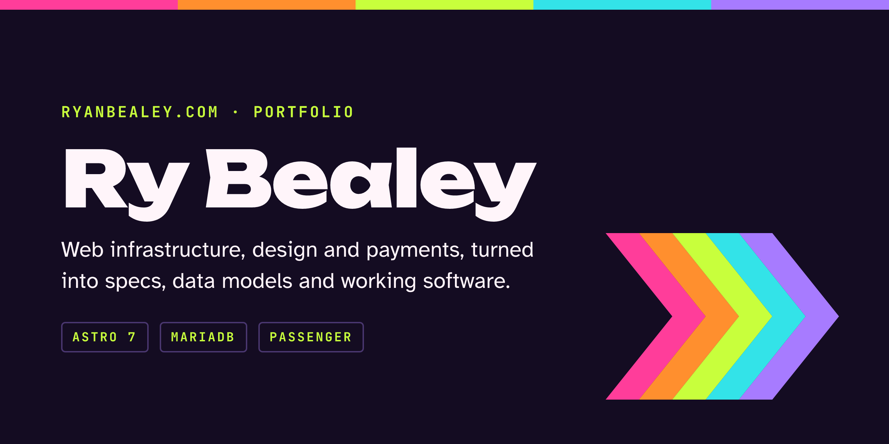

<p align="center">
  
</p>

<p align="center">
  
  
  
  
  
  <br>
  
  
  
  
</p>

<p align="center">
  The source for <a href="https://ryanbealey.com"><strong>ryanbealey.com</strong></a>: case studies, a microblog and a little personality, rendered live from MariaDB and served by Passenger on cPanel.
</p>

---

## Contents

- [What's inside](#whats-inside)
- [Stack](#stack)
- [Getting started](#getting-started)
- [Scripts](#scripts)
- [Project structure](#project-structure)
- [Content and the database](#content-and-the-database)
- [Design system](#design-system)
- [Spotify setup](#spotify-setup)
- [Deploy to cPanel](#deploy-to-cpanel)
- [Status and roadmap](#status-and-roadmap)

## What's inside

- **Bento home page.** A 12-column grid on CSS grid and container queries. The small tiles can be rearranged with a mouse, a pen or the keyboard (grip button, then the arrow keys), with each visitor's order saved in their browser. The hero, the case studies and the contact strip stay put, and touch devices always get the designed layout.
- **Case studies** at `/work/<slug>`. A home tile morphs into its case study's header through a cross-document View Transition.
- **Writing, a microblog.** Short, dated notes with one optional attachment: a link preview, a case study card or an image. Notes have permalinks, topic pages and month archives, an RSS feed, and a 1200×630 share card for each note.
- **Live content.** Case studies and notes live in MariaDB and every page renders on request, so new content shows within 30 seconds without a deploy.
- **Now playing.** A Spotify tile shows the current or last played track through a server-side endpoint, so the client secret never reaches the browser.
- **Light and dark.** Follows the system setting, defaults to light, remembers a visitor's choice, and fades between themes.
- **⌘K command palette** for jumping to any page, plus a skip link, visible focus and `prefers-reduced-motion` respected throughout.

## Stack

| Layer | Choice |
| --- | --- |
| Framework | [Astro 7](https://astro.build), TypeScript strict, `output: 'server'` with the Node adapter in standalone mode |
| Data | MariaDB 10.11 through `mysql2`; Docker locally, cPanel's database in production |
| Rendering | Markdown bodies rendered per request with `marked`, code colored by Shiki through theme-aware CSS variables |
| Styling | Plain CSS with cascade layers; custom properties generated from the design system's tokens |
| Images | Astro's image endpoint for site images (AVIF and WebP); stored images served by content hash |
| Share cards | Satori and resvg, rendered on first request and kept in memory |
| Fonts | Atkinson Hyperlegible, JetBrains Mono and Unbounded, self-hosted |
| Client JavaScript | About 5.5 KB gzipped on the home page, no framework |
| Hosting | cPanel and WHM, with Phusion Passenger running `app.cjs` |

## Getting started

You'll need Node.js 22.23.4 or newer and Docker.

```bash
npm install
cp .env.example .env    # then fill in the DB_ passwords; any values work locally
npm run db:up           # MariaDB 10.11 in Docker on 127.0.0.1:3307
npm run db:migrate      # create the tables
npm run db:seed         # load the starting content from db/seed/
npm run dev             # http://localhost:4321
```

`npm run dev` and `npm run build` regenerate `src/styles/tokens.css` from `design/tokens/` first. Never edit `tokens.css` by hand.

## Scripts

| Script | What it does |
| --- | --- |
| `npm run dev` | Tokens, then the Astro dev server on http://localhost:4321 |
| `npm run build` | Tokens, `astro check`, then the production build into `dist/` |
| `npm run preview` | Runs the built site through `app.cjs`, exactly as Passenger will |
| `npm run check` | Type-checks `.astro` and `.ts` files |
| `npm run db:up` | Starts the local MariaDB in Docker and waits until it's healthy |
| `npm run db:migrate` | Applies new files in `db/migrations/`, once each |
| `npm run db:seed` | Loads `db/seed/`; safe to rerun, never deletes |
| `npm run db:previews` | Fetches link previews for notes that don't have one yet (`-- --refresh` refetches all) |
| `npm run spotify:auth` | One-time Spotify login that saves a refresh token to `.env` |
| `npm run package` | Build, then bundle `release/ryanbealey.tar.gz` for cPanel |

`node scripts/render-banner.mjs` redraws this README's banner.

## Project structure

```text
.
├── app.cjs                 Passenger startup file; loads the built server
├── docker-compose.yml      Local MariaDB 10.11
├── db/
│   ├── migrations/         Numbered SQL files; add new ones, never edit old ones
│   └── seed/               The starting content as Markdown, plus cached link previews
├── deploy/                 Apache rules to add beside cPanel's Passenger block
├── design/tokens/          Ryvanse tokens and the derived work-register tokens
├── public/                 Fonts, favicon, robots.txt, llms.txt
├── scripts/                Tokens, database, Spotify, banner and release scripts
└── src/
    ├── assets/             Images processed by Astro, such as the About headshot
    ├── components/         Header, footer, palette, bento grid, tiles, Writing parts
    ├── data/               Site settings and the About page content
    ├── layouts/            Base page shell and the Writing layout
    ├── lib/                Database access, notes, case studies, Markdown, link previews, Spotify, bento logic
    ├── pages/              Routes, including /api/now-playing, /media and /sitemap.xml
    └── styles/             Global CSS and the generated tokens
```

## Content and the database

Case studies and notes will be published from companion iOS and macOS apps (a separate project) through an API this site will expose. Until then, add rows directly.

| Table | Holds |
| --- | --- |
| `case_studies` | One row per case study: order, label, title, summary, status, accent, metrics and a Markdown body. Only `published` rows appear. |
| `notes` | One row per note. The `slug` is the permalink and starts with the date. At most one attachment (`link_url`, `case_study_id` or `image_media_id`), and an image needs `image_alt`; the database enforces both. Drafts stay out of production. |
| `link_previews` | The unfurled preview for each shared URL, fetched once. |
| `media` | Images stored once by SHA-256 and served from `/media/<hash>.<ext>` with a year-long cache. |

- **Reading.** Pages read through `src/lib/work.ts` and `src/lib/notes.ts`, which hold lists in memory for 30 seconds.
- **Previews.** After adding a note with a link, run `npm run db:previews` to unfurl it.
- **Changing the schema.** Add a numbered file to `db/migrations/` and run `npm run db:migrate`. Never edit a migration that has already run anywhere.
- **Seed files.** `db/seed/` seeds local databases and the first production import. It isn't edited after that.

## Design system

The site uses the Ryvanse design system in a quieter "work" register. `design/tokens/ryvanse.tokens.json` is a copy of its tokens, and `ry-bealey.tokens.json` derives the portfolio's semantic colors for light and dark plus its long-form type. `scripts/build-tokens.mjs` turns both into the CSS custom properties in `src/styles/tokens.css`. Change the token files, not the generated CSS.

## Spotify setup

1. Create an app at https://developer.spotify.com/dashboard. Add the redirect URI `http://127.0.0.1:8888/callback` and pick Web API.
2. Fill in `SPOTIFY_CLIENT_ID` and `SPOTIFY_CLIENT_SECRET` in `.env`.
3. Run `npm run spotify:auth` and approve access in the browser tab it opens. The script writes `SPOTIFY_REFRESH_TOKEN` into `.env` for you.

Without these values the tile shows "Quiet right now" instead of failing.

## Deploy to cPanel

Astro 7 needs Node.js 22.23.4 or newer. If the server's 22.x is older, pick 24.

1. Run `npm run package` locally.
2. In cPanel, open **Setup Node.js App** and create an application:
   - Node.js version: 24 (or 22.23.4+)
   - Application mode: Production
   - Application root: `ryanbealey` (outside `public_html`)
   - Application URL: `ryanbealey.com`
   - Application startup file: `app.cjs`
   - Environment variables: the three `SPOTIFY_*` values, plus `DB_HOST=localhost`, `DB_PORT=3306`, `DB_NAME`, `DB_USER` and `DB_PASSWORD` for the database from cPanel → MySQL Databases
3. Upload `release/ryanbealey.tar.gz` to `~/ryanbealey` and extract it there. Don't upload `node_modules`; the Node.js selector manages that folder.
4. Back in Setup Node.js App, click **Run NPM Install**.
5. Over SSH (cPanel's Terminal works), create the tables and import the starting content once. The database values go on the command line here because cPanel's app variables don't reach the shell:

   ```bash
   source ~/nodevenv/ryanbealey/24/bin/activate && cd ~/ryanbealey
   export DB_HOST=localhost DB_PORT=3306 DB_NAME=… DB_USER=…
   read -s DB_PASSWORD && export DB_PASSWORD
   node scripts/db-migrate.mjs && node scripts/db-seed.mjs
   ```

6. Click **Restart**.
7. Add the rules from `deploy/htaccess.example` above cPanel's Passenger block in the domain's `.htaccess`.

For later deploys, upload and extract the new archive, then install, apply any new migrations (with the DB variables exported as above) and restart:

```bash
source ~/nodevenv/ryanbealey/24/bin/activate && cd ~/ryanbealey && npm ci --omit=dev && node scripts/db-migrate.mjs && touch tmp/restart.txt
```

## Status and roadmap

The MVP is planned to launch on **Nov 9, 2026**.

- [x] Bento home page, light and dark themes, ⌘K palette, page transitions
- [x] About page with timeline, toolkit and headshot
- [x] Writing: feed, permalinks, topic pages, month archives, link previews, share cards, RSS
- [x] Live content from MariaDB, with Docker for local development
- [x] Spotify now playing
- [ ] Production database set up on cPanel, then the first deploy
- [ ] Publishing API for the iOS and macOS apps
- [ ] Full case-study write-ups, plus the Resume and Colophon pages
- [ ] GTM and GA4 (tiles already carry `data-ga-event` attributes for `resume_download` and `contact_click`)
- [ ] GitHub handle, resume PDF and Spotify profile link in `src/data/site.ts`
